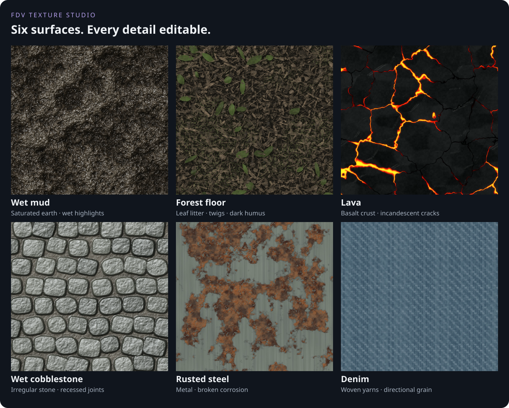
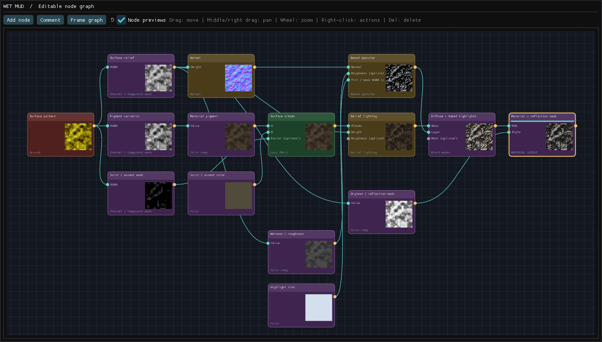

# FDV Texture Studio

### From a node graph to your next game texture.

**Procedural materials · Animated effects · Dreamcast texture tools**

Create textures, inspect them in 3D, and export them for your game. 
A native desktop workspace for Windows and Linux.

**[Download from Releases](https://github.com/freakdave/FDV-Texture-Studio/releases)** &nbsp; · &nbsp;
**[Explore the features](#built-for-the-whole-texture-workflow)** &nbsp; · &nbsp;
**[User guide](docs/USER_GUIDE.md)**

**94 presets** &nbsp; / &nbsp; **78 node types** &nbsp; / &nbsp; **Up to 4096 × 4096**

*Actual preset renders. Editable graphs, colors, surface detail, and material settings.*

## Make it yours

Start with a material or effect from the searchable preset library. Change its
seed, colors, surface detail, or animation; then follow the graph as far as your
idea takes you. Save your own presets and return to them whenever you need a new
variation.

The screenshots and texture samples below come from FDV Texture Studio itself.
The materials are procedural, editable starting points, not photographic scans.

## A library of surfaces

Explore masonry, stone, concrete, terrain, sand, foliage, wood, metal, fabric,
leather, rubber, glass, water, and wet or polished surfaces—alongside animated
weather, fire, and energy effects.

## Built for the whole texture workflow

|                                | What you can do                                                                                                                                                                   |
| :----------------------------- | :-------------------------------------------------------------------------------------------------------------------------------------------------------------------------------- |
| **Build visually**             | Connect 78 node types: generators, surface patterns, math, masks, color, filters, normals, coordinates, textures, and animation. Dark category colors make graphs easier to read. |
| **Work with detail**           | Generate textures from 32 × 32 up to 4096 × 4096. Inspect available material, albedo, height, and normal outputs.                                                                 |
| **Preview in context**         | Orbit a sphere, cube, or plane. Inspect 2 × 2 tiling, transparency, reflections, and material motion.                                                                             |
| **Keep editing comfortably**   | Use background node thumbnails, searchable nodes and presets, comment groups, Undo/Redo, and individual setting resets.                                                           |
| **Mix your own ingredients**   | Import images, sample another preset, combine layers with masks, and save reusable custom presets.                                                                                |
| **Animate and export**         | Preview loops, scrub frames, and export sprite sheets with frame rectangles, FPS, and duration in a JSON sidecar.                                                                 |
| **Prepare final textures**     | Resize, generate or replace mip levels, encode textures, and compare the decoded result with the original.                                                                        |
| **Work with Dreamcast assets** | Use the bundled native PVR encoder, palette formats, VQ compression, mipmaps, and FDV material bundles.                                                                           |

### See how the surface is built

*The Wet mud graph, shown separately at a readable scale. Each node remains editable.*

### See the material as you work

The texture and 3D views share the same material settings. Inspect a flat image,
check seams with tiling, or orbit the preview mesh to judge its appearance.
Wet and polished presets include controls for baked highlights and FDV environment
reflections.

### Put your textures in motion

_Lava flow: stationary basalt, moving molten detail inside the cracks._

Create looping lava, magma, water, rain, fire, smoke, sparks, energy shields,
plasma arcs, and more. The animation controls let you set frame count, FPS,
sheet columns, and preview speed. Export a single frame or an entire sprite sheet.

**Lava flow** preserves the static Lava preset's crust and narrow cracks.
**Magma flow** exposes broader molten currents moving around stationary rock islands.

### From modern image files to Dreamcast textures

| Workflow               | Formats and tools                                                                                                                                                                   |
| :--------------------- | :---------------------------------------------------------------------------------------------------------------------------------------------------------------------------------- |
| **Images**             | Import and export PNG and JPEG.                                                                                                                                                     |
| **Dreamcast textures** | DTEX / TEX, DT, and PVR containers; PAL palette files. Encoding options include RGB565, ARGB1555, ARGB4444, YUV422, PAL4, PAL8, BUMP, and NORMAL, subject to container constraints. |
| **Animation**          | Sprite-sheet export with a `.sprites.json` sidecar; PNG supports transparency.                                                                                                      |
| **Editable graphs**    | Save and reopen `.fdvgraph` documents, including animation and material settings.                                                                                                   |
| **FDV materials**      | Export a portable `.fdvmat` bundle with textures, optional Dreamcast DTEX files, and the creator graph.                                                                             |
| **Quality checks**     | Side-by-side, wipe, and amplified difference views of the source and actual encoded texture.                                                                                        |

## Download

**Get the application from [GitHub Releases](https://github.com/freakdave/FDV-Texture-Studio/releases).**
Open a release and choose one of its assets:

| Platform         | Package                                             | Best for                                                              |
| :--------------- | :-------------------------------------------------- | :-------------------------------------------------------------------- |
| **Windows x64**  | `FDV-Texture-Studio-0.1.0-Windows-x64-Setup.exe`    | A per-user install with an uninstaller and optional desktop shortcut. |
| **Windows x64**  | `FDV-Texture-Studio-0.1.0-Windows-x64-portable.zip` | Extract and run `fdv-texture-studio.exe`.                             |
| **Linux x86-64** | `fdv-texture-studio_0.1.0_amd64.deb`                | Install on a compatible Debian/Ubuntu system.                         |
| **Linux x86-64** | `fdv-texture-studio-0.1.0-linux-x86_64.zip`         | Extract and run `launch-texture-studio.sh`.                           |

Each release includes `SHA256SUMS` for verifying the downloads. Choose a named
application package from **Assets**; GitHub's automatic “Source code” archives
contain this showcase repository, not the application.

**Requirements:** a 64-bit Windows or Linux desktop and a working OpenGL 3.3
graphics driver. The current Linux packages require glibc 2.38 or newer and
X11 or XWayland. The native PVR encoder is included; KOS and WSL are not needed
to run the release packages.

## Your first texture

1. **Choose a preset** in GPU Creator. Pick a resolution and seed.
2. **Make it your own.** Select nodes to edit colors, shapes, surface detail, or animation.
3. **Inspect the result.** Switch between Texture and 3D material; enable 2 × 2 tiling to check repeats.
4. **Export.** Save an image, export a sprite sheet, or use the converter for Dreamcast encoding. Save the graph to keep it editable.

See the **[user guide](docs/USER_GUIDE.md)** for graph controls, animation,
conversion, and material export.

## About this repository

This is the public showcase, documentation, and binary release home for
**FDV Texture Studio**. The application's source code is not published here.

Third-party components retain their respective licenses. Release packages include
their notices and the corresponding source for the separately bundled PVR encoder.
That encoder source is separate from the private FDV Texture Studio application.

Found a problem or have an idea? **[Open an issue](https://github.com/freakdave/FDV-Texture-Studio/issues)**
with your app version, operating system, and steps to reproduce it. A screenshot
or a small example graph is helpful.
