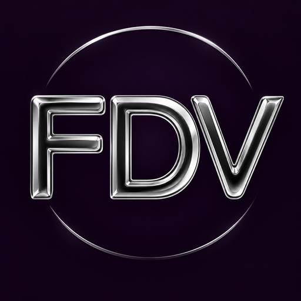
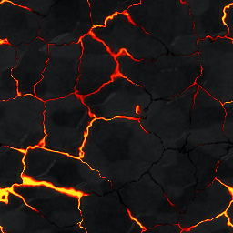
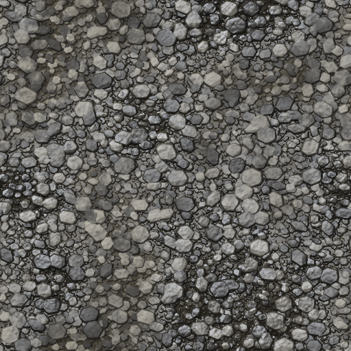
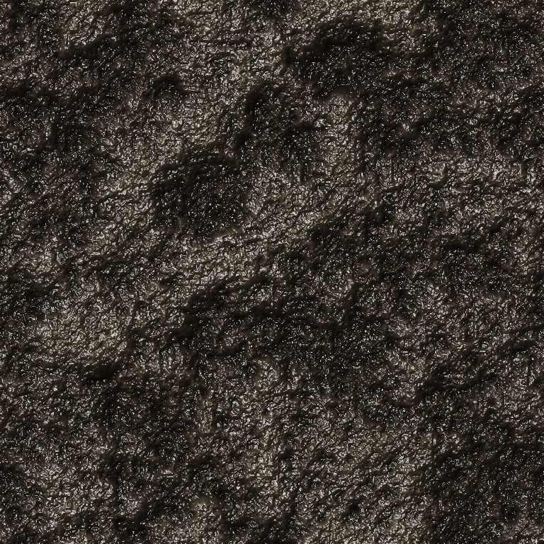
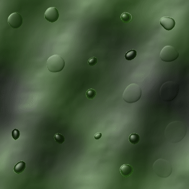
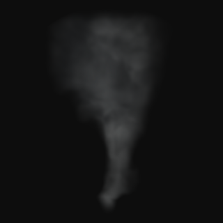
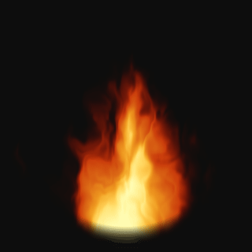
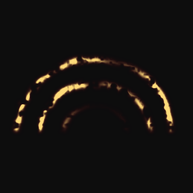
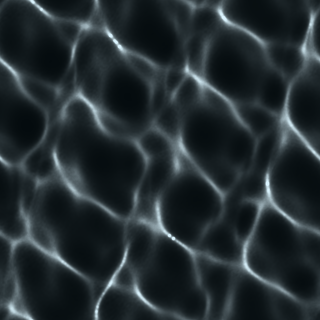
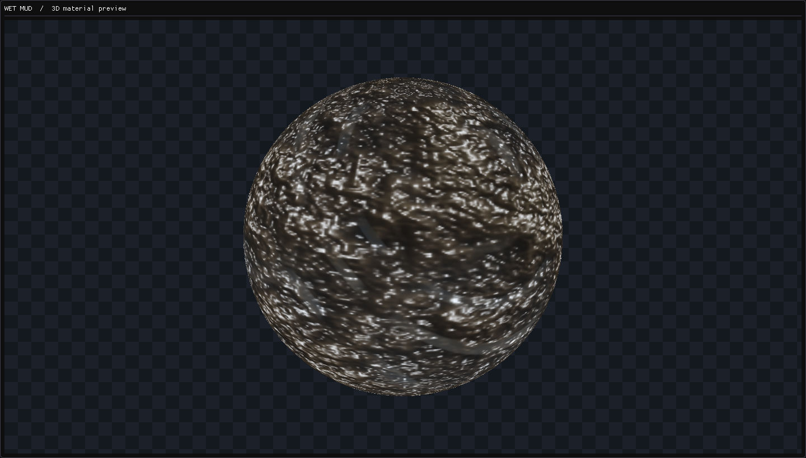

# FDV Texture Studio

**Procedural materials · Animated effects · Dreamcast texture tools**

Create textures, inspect them in 3D, and export them for your game. 
A native desktop workspace for Windows and Linux.

**[Download from Releases](https://github.com/freakdave/FDV-Texture-Studio/releases)** &nbsp; · &nbsp;
**[Explore the features](#built-for-the-whole-texture-workflow)** &nbsp; · &nbsp;
**[User guide](docs/USER_GUIDE.md)**

**94 presets** &nbsp; / &nbsp; **78 node types** &nbsp; / &nbsp; **Up to 4096 × 4096**

<table width="100%">
  <tr>
    <td align="center" width="25%"> <b>Lava flow</b></td>
    <td align="center" width="25%"> <b>Wet gravel</b></td>
    <td align="center" width="25%"> <b>Wet mud</b></td>
    <td align="center" width="25%"> <b>Acid bubbles</b></td>
  </tr>
  <tr>
    <td align="center" width="25%"> <b>Billowing smoke</b></td>
    <td align="center" width="25%"> <b>Fire plume</b></td>
    <td align="center" width="25%"> <b>Plasma arcs</b></td>
    <td align="center" width="25%"> <b>Water caustics</b></td>
  </tr>
</table>

## Materials and effects

Choose from 94 presets covering stone, gravel, mud, wood, metal, fabric, glass,
water, fire, smoke, and energy effects.  
Adjust the seed, colors, surface detail, and animation, or build a graph from scratch.  
Save custom presets for reuse.

## Built for the whole texture workflow

|                                | What you can do                                                                                                                                                                   |
| :----------------------------- | :-------------------------------------------------------------------------------------------------------------------------------------------------------------------------------- |
| **Build visually**             | Connect 78 node types: generators, surface patterns, math, masks, color, filters, normals, coordinates, textures, and animation. Dark category colors make graphs easier to read. |
| **Work with detail**           | Generate textures from 32 × 32 up to 4096 × 4096. Inspect available material, albedo, height, and normal outputs.                                                                 |
| **Preview in context**         | Orbit a sphere, cube, or plane. Inspect 2 × 2 tiling, transparency, reflections, and material motion.                                                                             |
| **Keep editing comfortably**   | Use background node thumbnails, searchable nodes and presets, comment groups, Undo/Redo, and individual setting resets.                                                           |
| **Mix your own ingredients**   | Import images, sample another preset, combine layers with masks, and save reusable custom presets.                                                                                |
| **Animate and export**         | Preview loops, scrub frames, and export sprite sheets with frame rectangles, FPS, and duration in a JSON sidecar.                                                                 |
| **Prepare final textures**     | Resize, generate or replace mip levels, encode textures, and compare the decoded result with the original.                                                                        |
| **Work with Dreamcast assets** | Use the bundled native PVR encoder, palette formats, VQ compression, mipmaps, and FDV material bundles.                                                                           |

### Interactive Node Graph

_Acid bubbles: animated node previews._

### Preview materials in 3D views

The texture and 3D views share the same material settings. Inspect a flat image,
check seams with tiling, or orbit the preview mesh to judge its appearance.
Wet and polished presets include controls for baked highlights and FDV environment
reflections.

### Animate textures and export into sprite sheets

Create looping lava, magma, water, rain, fire, smoke, sparks, energy shields,
plasma arcs, and more. The animation controls let you set frame count, FPS,
sheet columns, and preview speed. Export a single frame or an entire sprite sheet.

### From modern image files to Dreamcast textures

| Workflow               | Formats and tools                                                                                                                                                                   |
| :--------------------- | :---------------------------------------------------------------------------------------------------------------------------------------------------------------------------------- |
| **Images**             | Import and export PNG and JPEG.                                                                                                                                                     |
| **Dreamcast textures** | DTEX / TEX, DT, and PVR containers; PAL palette files. Encoding options include RGB565, ARGB1555, ARGB4444, YUV422, PAL4, PAL8, BUMP, and NORMAL, subject to container constraints. |
| **Animation**          | Sprite-sheet export with a `.sprites.json` sidecar; PNG supports transparency.                                                                                                      |
| **Editable graphs**    | Save and reopen `.fdvgraph` documents, including animation and material settings.                                                                                                   |
| **FDV materials**      | Export a portable `.fdvmat` bundle with textures, optional Dreamcast DTEX files, and the creator graph.                                                                             |
| **Quality checks**     | Side-by-side, wipe, and amplified difference views of the source and actual encoded texture.                                                                                        |

## Download

**Get the application from [GitHub Releases](https://github.com/freakdave/FDV-Texture-Studio/releases).**

**Requirements:** a 64-bit Windows or Linux desktop and a working OpenGL 3.3
graphics driver. The current Linux packages require glibc 2.38 or newer and
X11 or XWayland. The native PVR encoder is included; KOS and WSL are not needed
to run the release packages.

## Your first texture

1. **Choose a preset** in GPU Creator. Pick a resolution and seed.
2. **Make it your own.** Select nodes to edit colors, shapes, surface detail, or animation.
3. **Inspect the result.** Switch between Texture and 3D material; enable 2 × 2 tiling to check repeats.
4. **Export.** Save an image, export a sprite sheet, or use the converter for Dreamcast encoding. Save the graph to keep it editable.

See the **[user guide](docs/USER_GUIDE.md)** for graph controls, animation,
conversion, and material export.

## About this repository

This is the public showcase, documentation, and binary release home for
**FDV Texture Studio**.  
The application's source code is not published here.

Third-party components retain their respective licenses. Release packages include
their notices and the corresponding source for the separately bundled PVR encoder.
That encoder source is separate from the private FDV Texture Studio application.

Found a problem or have an idea? **[Open an issue](https://github.com/freakdave/FDV-Texture-Studio/issues)**
with your app version, operating system, and steps to reproduce it.  
A screenshot or a small example graph is helpful.
