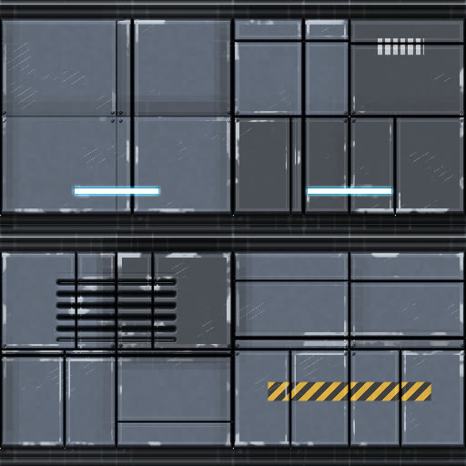
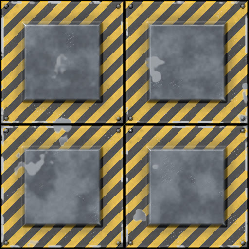
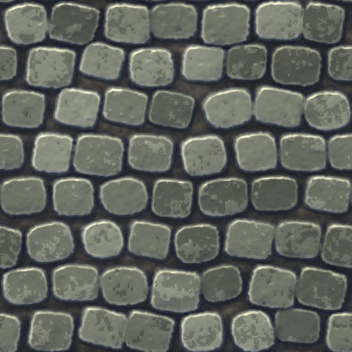
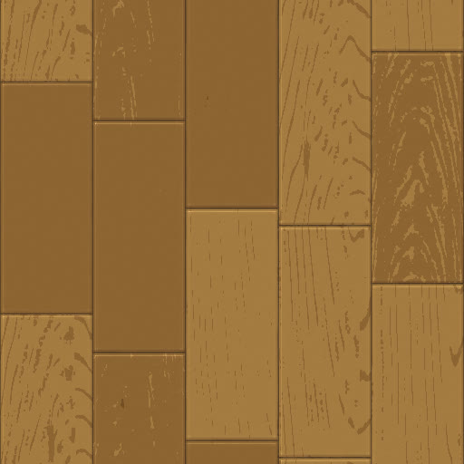

# FDV Texture Studio

**Procedural materials · Animated effects · Dreamcast texture tools**

Create textures, inspect them in 3D, and export them for your game.  A native desktop workspace for Windows and Linux.

**[Download from Releases](https://github.com/freakdave/FDV-Texture-Studio/releases)** &nbsp; · &nbsp; **[Explore the features](#built-for-the-whole-texture-workflow)** &nbsp; · &nbsp; **[User guide](docs/USER_GUIDE.md)**

**110 presets** &nbsp; / &nbsp; **79 node types** &nbsp; / &nbsp; **Up to 4096 × 4096**

<table width="100%">
  <tr>
    <td align="center" width="25%"> <b>Lava flow</b></td>
    <td align="center" width="25%"> <b>Wet gravel</b></td>
    <td align="center" width="25%"> <b>Wet mud</b></td>
    <td align="center" width="25%"> <b>Acid bubbles</b></td>
  </tr>
  <tr>
    <td align="center" width="25%"> <b>Billowing smoke</b></td>
    <td align="center" width="25%"> <b>Fire plume</b></td>
    <td align="center" width="25%"> <b>Plasma arcs</b></td>
    <td align="center" width="25%"> <b>Water caustics</b></td>
  </tr>
  <tr>
    <td align="center" width="25%"> <b>Sci-fi panels</b></td>
    <td align="center" width="25%"> <b>Hazard plating</b></td>
    <td align="center" width="25%"> <b>Toon cobblestone</b></td>
    <td align="center" width="25%"> <b>Toon planks</b></td>
  </tr>
</table>

## Materials and effects

Choose from 110 presets covering stone, gravel, mud, wood, metal, fabric, glass, water, fire, smoke, and energy effects. 
New in 0.3.0: weathered **Sci-fi** panels and hand-painted **Stylized** materials for toon-style games. 
Adjust the seed, colors, surface detail, and animation, or build a graph from scratch. 
Save custom presets for reuse.

## Built for the whole texture workflow

| Feature | What you can do |
| :--- | :--- |
| **Node editor** | Build graphs of up to 256 nodes from 79 node types, with animated thumbnails and colored categories. |
| **Workspace** | Dock and resize panels, focus on the node graph with a 3D corner preview, and save up to four layouts. |
| **Materials** | Generate up to 4096 × 4096 with material, albedo, height, and normal outputs. |
| **3D preview** | Inspect a sphere, cube, or plane with tiling and environment reflections. |
| **Animation** | Preview loops and export sprite sheets with frame and timing metadata. |
| **Reusable graphs** | Import images, copy nodes between graphs, and save presets or node groups. |
| **Dreamcast tools** | Encode textures with palettes, VQ compression, and mipmaps, then compare the result. |

### Interactive Node Graph

_Acid bubbles: animated node previews._

### Preview materials in 3D views

Switch between the texture and 3D views to check seams, surface detail, and reflections. 
_Grimy space panels: the environment reflects only through chips, scratches, and stains._

Export PNG or JPEG images, animated sprite sheets, Dreamcast textures, or FDV material bundles. 
Save a `.fdvgraph` to keep your work editable.

See the [user guide](docs/USER_GUIDE.md) for export formats and settings, and [File formats](docs/FILE_FORMATS.md) to read exports in another engine.

## Download

**Get the application from [GitHub Releases](https://github.com/freakdave/FDV-Texture-Studio/releases).**

| Platform | Installation options |
| :--- | :--- |
| **Windows** | Setup installer or portable ZIP. |
| **Linux** | DEB package or portable ZIP. |

**Requirements:** a 64-bit Windows or Linux desktop and a working OpenGL 3.3 graphics driver. 
The current Linux packages require glibc 2.38 or newer and X11 or XWayland. 
The native PVR encoder is included. 
KOS and WSL are not needed to run the release packages.

## Your first texture

1. **Choose a preset** in Texture Creator. Pick a resolution and seed.
2. **Make it your own.** Select nodes to edit colors, shapes, surface detail, or animation.
3. **Inspect the result.** Switch between Texture and FDV material. Set **Tiling** to 2 × 2 or 4 × 4 to check repeats.
4. **Export.** Save an image, export a sprite sheet, or use the Texture Converter for Dreamcast encoding. Save the graph to keep it editable.

See the **[user guide](docs/USER_GUIDE.md)** for graph controls, animation, conversion, and material export.

## About this repository

This is the public showcase, documentation, and binary release home for **FDV Texture Studio**. 
The application's source code is not published here.

Third-party components retain their respective licenses. 
Release packages include their notices and the corresponding source for the separately bundled PVR encoder. 
That encoder source is separate from the private FDV Texture Studio application.

Found a problem or have an idea? **[Open an issue](https://github.com/freakdave/FDV-Texture-Studio/issues)** with your app version, operating system, and steps to reproduce it. 
A screenshot or a small example graph is helpful.
