# FDV Texture Studio · User guide

[← Back to the README](../README.md)

## What do you want to do?

| Task                               | Go to                                                                            |
| :--------------------------------- | :------------------------------------------------------------------------------- |
| Make your first texture            | [Create a texture](#create-and-edit)                                             |
| Arrange panels or focus the graph  | [Workspace and layouts](#arrange-the-workspace)                                  |
| Save or find a preset              | [Preset library](#find-and-reuse-presets)                                        |
| Connect, copy, or bypass nodes     | [Edit a graph](#edit-a-graph)                                                    |
| Check a material or mask           | [3D preview](#preview-materials) · [Texture channels](#inspect-texture-channels) |
| Export an animation                | [Animation and sprite sheets](#animate-and-export-a-sprite-sheet)                |
| Encode a Dreamcast texture         | [Convert and compare](#convert-and-compare)                                      |
| Export to FDV Editor               | [FDV material bundles](#export-an-fdv-material)                                  |
| Configure autosave or recover work | [Preferences and recovery](#preferences-autosave-and-recovery)                   |

[Installation](#start-here) · [Updating](#update-an-existing-installation) · [Shortcuts](#shortcuts)

## Start here

Download a package from [GitHub Releases](https://github.com/freakdave/FDV-Texture-Studio/releases).

| Package                  | How to start                                        |
| :----------------------- | :-------------------------------------------------- |
| **Windows installer**    | Run Setup, then open FDV Texture Studio.            |
| **Windows portable ZIP** | Extract the ZIP and run `fdv-texture-studio.exe`.   |
| **Linux DEB**            | Install the package, then open FDV Texture Studio.  |
| **Linux portable ZIP**   | Extract the ZIP and run `launch-texture-studio.sh`. |

You need a 64-bit desktop and an OpenGL 3.3 driver.<br>
Linux also requires glibc 2.38 or newer and X11 or XWayland.<br>
The native PVR encoder is included.

If the status bar reports **CPU rendering fallback**, check your graphics driver.

## Update an existing installation

Close Texture Studio before updating. There is no need to uninstall first.

- **Windows installer:** run the new Setup file. It replaces the application files and keeps your shortcut preference.
- **Linux DEB:** install the newer package with your package manager.
- **Portable ZIP:** extract the complete new ZIP into a fresh folder. Keep any graphs and imported images stored in the old folder.

Saved graphs and custom presets are kept when updating installed packages.

<details>
<summary>Linux install command and custom preset locations</summary>

From the download folder, run:

```sh
sudo apt install ./fdv-texture-studio_0.3.0_amd64.deb
```

Custom presets are stored outside the installation folder:

- **Windows:** `%LOCALAPPDATA%\FDV Texture Studio\presets`
- **Linux:** `$XDG_DATA_HOME/fdv-texture-studio/presets`, normally `~/.local/share/fdv-texture-studio/presets`

Files supplied with the application are replaced by the update.

</details>

## Create and edit

1. Open **Texture Creator** and choose a preset.<br>Texture Studio starts with **New graph**: a Checker node assigned as the material output.
2. Set the resolution and seed.
3. Select a node to edit its settings in the inspector.
4. Switch between **Texture** and **FDV material** to check the result.
5. Choose **Export texture...** to save an image.<br>Use **Save graph** to retain the editable `.fdvgraph` document.


_The Node inspector shows the selected node's settings. Here, Material pigment controls the colors._

<details>
<summary>Import images into a graph</summary>

Use **Texture sample** for independent images or preset snapshots.<br>
**Source image (shared)** uses the graph's shared imported image.

Keep copied source images beside the saved graph when moving it to another folder or computer.

</details>

## Arrange the workspace

Texture Creator has five panels: **Controls**, **Node inspector**, **Preview**, **Node graph**, and **FDV material**.

- Drag a panel's tab to dock it elsewhere, tab it with another panel, or float it.
- Drag the border between panels to resize them.
- Close a panel with its **×**. Show it again from the **View** menu.
- **View > Reset layout** restores the default arrangement.

Texture Studio keeps your arrangement for the next session. The Texture Converter has its own layout.

### Focus on the node graph

Click **Focus graph** in the node graph toolbar, choose **View > Focus graph**, or press **F11**.<br>
The node graph fills the window. Click **Exit focus** or press **F11** again to return.

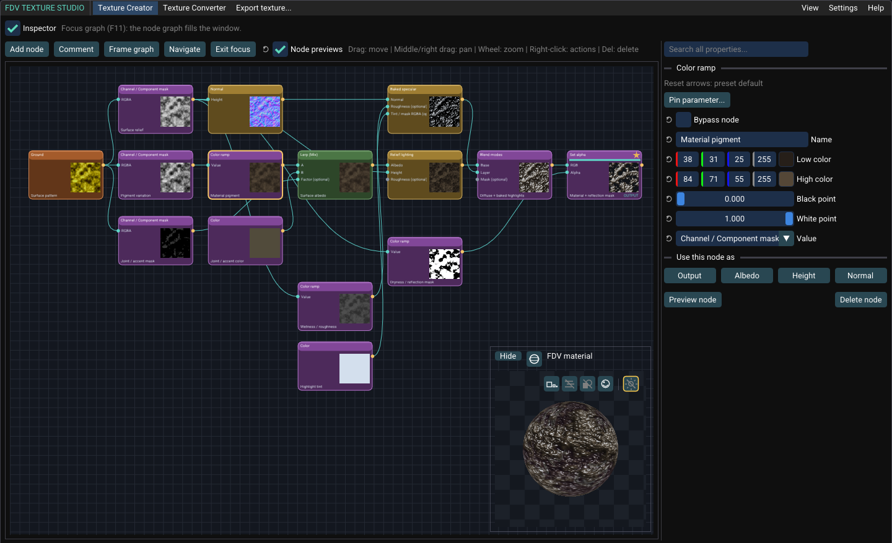

- The 3D material preview in the corner works like the FDV material view. Drag it to orbit. Click its shape icon to switch between sphere, cube, and plane. **Hide** collapses it.
- The node inspector sits in a column on the right. Drag its edge to resize it, or clear **Inspector** to hide it.
- The corner preview also appears when the Preview panel is closed.

### Save a layout

1. Arrange the panels.
2. Choose **View > Layouts > Save layout as...** and enter a name.
3. To return to it later, choose its name under **View > Layouts**.

A layout keeps the panel arrangement, which panels are shown, and Focus graph with its inspector column.<br>
You can keep up to four layouts. Saving under an existing name replaces that layout. **Delete layout** removes one.

## Find and reuse presets

1. Click **Browse presets...** above the preset menu.
2. Search by name or description, or filter by category.<br>Mark frequently used presets as favorites.<br>
   The **Sci-fi** category has weathered panels whose metal reflects only where it is worn. **Stylized** has hand-painted materials for toon-style games.
3. Hover a thumbnail to preview motion. Click it to load the preset.

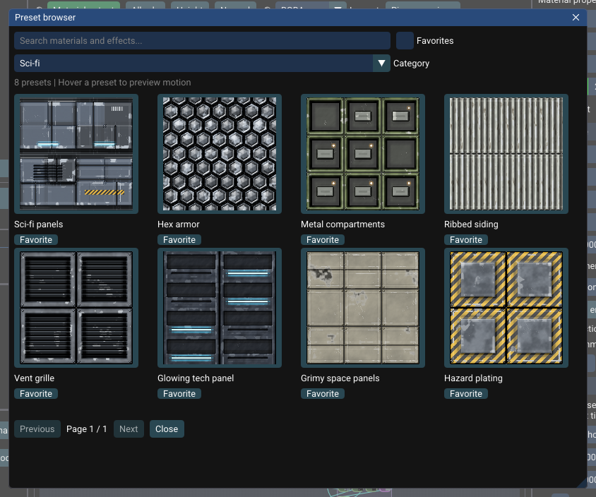

Custom presets also have thumbnails, generated from their saved graphs and imported images.

### Save or delete a custom preset

- **Save:** click **Save preset…** below the graph save buttons to add the current graph to the library.
- **Load:** choose the custom preset to create an unsaved working copy.
- **Delete:** click **Delete preset…**, choose a preset, and confirm **Delete**.<br>The current graph and source images are kept.

These actions are also available under **Presets → Custom**.

## Edit a graph

Drag between pins to connect nodes.<br>
Drag a pin onto empty canvas to open a menu of compatible nodes, then choose a result to connect it automatically.


_Double-click a node to inspect its output in the main preview._

### Follow and organize connections

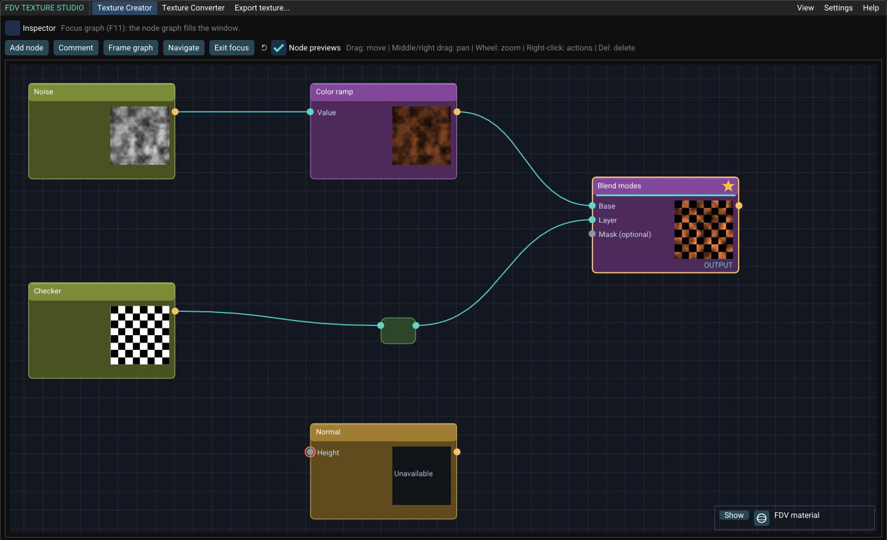

| Indicator or action    | Meaning                                                         |
| :--------------------- | :-------------------------------------------------------------- |
| **Header and footer**  | The header shows the node type. The footer shows the node's own name, with **OUTPUT** or **BYPASSED** at its right end. |
| **Gold star**          | This node is the material output.                               |
| **Red input ring**     | A required input is missing.                                    |
| **Hover a wire**       | Highlight its path and show the connected node and input names. |
| **Right-click a wire** | Disconnect it, insert a Reroute, or find either endpoint.       |
| **Drag a Reroute**     | Reposition the wire without changing its values.                |

To insert a node, drag its header until the node's center crosses a compatible wire.<br>
Release when the insertion hint appears. Hold **Alt** to move without inserting.

<details>
<summary>Connection rules and thumbnail controls</summary>

The connected-node menu names the input it will use.<br>
Enable **All nodes** to see other combinations, or drag backwards from an input to create its source.

Wire insertion requires an available compatible input.<br>
Existing inputs are kept. Connections that would introduce a cycle are rejected.<br>
Moving and inserting a node is one Undo step.

Right-click a node and choose **Freeze thumbnail** to stop its thumbnail updates.<br>
Choose **Resume thumbnail** to enable updates again.<br>
This does not affect the node's output or exports.

</details>

### Copy nodes between graphs

1. Select nodes and press **Ctrl+C**.
2. Open another graph or choose a preset.
3. Point at the canvas and press **Ctrl+V**.

Settings, images, comment membership, and connections within the selection are copied.<br>
Connections to unselected nodes are left open. The clipboard lasts while this application instance is open.

<details>
<summary>What changes when pasting or duplicating?</summary>

Pasted nodes use the destination graph's seed, animation settings, and resolution.<br>
The destination material output stays unchanged, so pasting may not reproduce the source material's final appearance.<br>
A copied shared source image becomes an independent Texture sample.

**Ctrl+D** duplicates nodes within the current graph and retains their incoming connections.<br>
Undo removes an entire paste or duplication in one step.

</details>

### Bypass a node

Right-click a compatible node and choose **Bypass node**, or use its inspector checkbox.<br>
It passes through its first input while keeping its settings and connections.

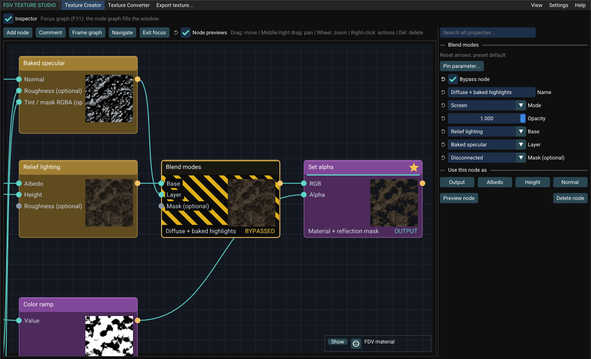

Bypass changes the final texture and exports. Toggle it off or use Undo to restore the operation.<br>
Generators and operations without a suitable source input do not offer bypass.

### Pin frequently used parameters

Pinned controls let you adjust selected node settings from one place.

1. Select a node and click **Pin parameter...** in its inspector.
2. Choose a parameter. It appears under **Pinned controls** in the Controls panel, below **Use in Texture Converter**.
3. Use **...** beside the control to rename it, reorder it, find its node, or unpin it.

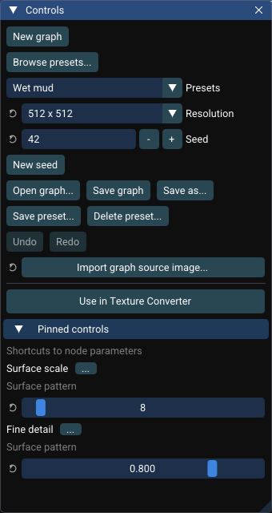

A pinned control edits the original parameter. It does not create a node or a separate value.<br>
Unpinning removes only the shortcut. Pinned controls are saved with the graph.

Use **Search all properties...** to find parameters by name or node.<br>
Edit matching values in the results, or use **Find node** to locate their owner.

### Edit colors

Color settings, such as a **Color** node or the **Low color** and **High color** of a **Color ramp**, show one swatch with its values.<br>
Click the swatch to open the color picker: a hue wheel, an alpha bar, and RGB, HSV, and hex fields.

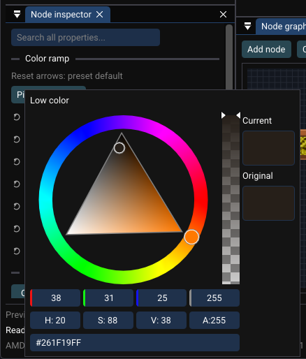

Narrow panels show only the swatch. Pinned controls, property search, and FDV material colors use the same picker.

### Choose which node supplies each map

A graph has four maps. Each map comes from one node:

| Map        | Used by                                                                                  |
| :--------- | :--------------------------------------------------------------------------------------- |
| **Output** | Export texture, Export sprite sheet, Export FDV material, and the Preview's **Material output** |
| **Albedo** | The Preview's **Albedo** button and Texture Sample nodes that read this graph's Albedo   |
| **Height** | The Preview's **Height** button and Texture Sample nodes that read this graph's Height   |
| **Normal** | The Preview's **Normal** button and Texture Sample nodes that read this graph's Normal   |

The buttons under **Use this node as** in the node inspector assign these maps.<br>
A green button means the selected node supplies that map. Click a button to move that map to the selected node.<br>
Point at a button to see which node supplies the map now. Right-click it to revert the map.

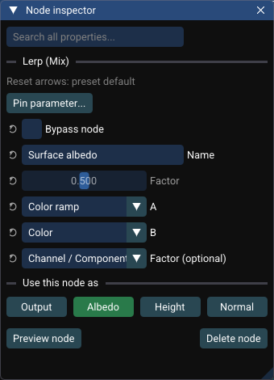

These buttons assign maps. The Preview's buttons with the same names only show them.

### Save reusable node groups

1. Select nodes, right-click, and choose **Save selection as group...**.
2. Enter a name and click **Save selected nodes**.
3. Open **Settings > Node groups...** to insert or delete library groups.

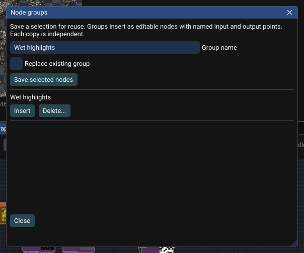

Connect the named **Input:** and **Output:** points after inserting a group.<br>
Each copy contains editable nodes, imported images, and pinned controls.<br>
Changing a library group does not change copies already inserted into graphs.

<details>
<summary>Node category colors</summary>

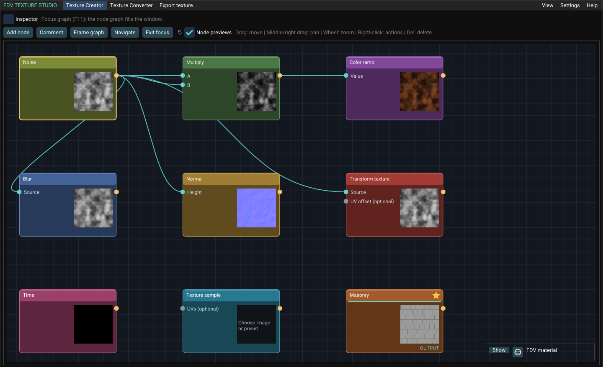

| Category             | Color     |
| :------------------- | :-------- |
| Generators           | Olive     |
| Math and masks       | Green     |
| Color and channels   | Purple    |
| Filters              | Blue      |
| Normals and lighting | Amber     |
| Coordinates          | Red       |
| Animation            | Rose      |
| Textures             | Cyan-blue |
| Material patterns    | Orange    |

</details>

### Shortcuts

Graph shortcuts apply while the canvas has focus. Text fields use normal text-editing shortcuts.

| Action                                | Control                                                  |
| :------------------------------------ | :------------------------------------------------------- |
| New graph                             | **Ctrl+N**                                               |
| Focus graph / exit focus              | **F11**                                                  |
| Copy / paste nodes                    | **Ctrl+C** / **Ctrl+V**                                  |
| Duplicate nodes                       | **Ctrl+D**                                               |
| Select all nodes                      | **Ctrl+A**                                               |
| Select several nodes                  | **Shift-click**, or drag a selection box on empty canvas |
| Undo / redo                           | **Ctrl+Z** / **Ctrl+Y**                                  |
| Add a comment around the selection    | **C** or **Comment**                                     |
| Frame the selection / find the output | **F** / **Home**                                         |
| Pan / zoom                            | Middle or right mouse drag / mouse wheel                 |
| Inspect a node's output               | Double-click the node                                    |
| Bypass a compatible node              | Right-click the node → **Bypass node**                   |
| Disconnect an input                   | Right-click its pin                                      |
| Enter an exact value                  | Double-click or **Ctrl+click** a numeric slider          |
| Reset one setting                     | Reset arrow, or right-click → **Revert to default**      |

## Preview materials

1. Select **FDV material** above the preview.
2. Choose **Sphere**, **Cube**, or **Plane**.
3. Drag to orbit and scroll to zoom. **Reset view** restores the camera.
4. Set **Tiling** to 2 × 2 or 4 × 4 to check repeats, or enable **Material motion** to preview scrolling.
5. Use the icons in the top-right corner of the view:
   - **Mipmapped preview**, **Preview fog**, **Show occluder**, and **Environment map** are preview only. They are never exported.
   - The gold-framed sun switches scene lighting on or off. A gray, crossed-out sun means the material is **Unlit**.
     This setting is saved in the FDV material.

| Tab              | Shows                                            | Saved by                                    |
| ---------------- | ------------------------------------------------ | ------------------------------------------- |
| **Texture**      | The flat texture                                 | **Export texture**, **Export sprite sheet** |
| **FDV material** | The texture on a mesh with its material settings | **Export FDV material**                     |

Material settings such as **Unlit**, tint, and reflections are never baked into exported textures or sprite sheets.


Texture export uses the selected preview output.<br>
FDV material export uses **Material output**. Tiling the preview does not change exports.

### Keep editing responsive

Choose **Auto** preview quality to reduce working resolution during editing and playback.<br>
The default limit is 512 × 512. Change it in **Settings > Preferences...**.

Idle previews return to the graph resolution. **Full quality** always uses that resolution.<br>
Exports use the requested document resolution. The status bar shows preview and export dimensions.

### Shader status

Texture Studio turns each graph into GPU shaders. A change that adds, removes, or reconnects nodes needs new shaders; changing a setting does not.

The right end of the status bar shows the state:

- **Compiling shaders** (red): the preview or the node thumbnails are compiling. The preview keeps its last image meanwhile.
- **Shaders compiled** (green): everything is ready.

Compiled shaders are kept between sessions, so a preset or graph you opened before loads without compiling.<br>
**Settings > Preferences > Shader cache** shows the cache size and clears it. After a graphics driver update, shaders compile again automatically.

<details>
<summary>Wet materials, alpha masks, and reflections</summary>

Wet presets can use alpha as a reflection mask.<br>
**Reflect holes (add)** and **Mirror holes (replace)** use inverse texture alpha:

- Opaque pixels receive no environment reflection.
- Transparent pixels receive full reflection.
- Intermediate alpha gives partial reflection.

Select **Dryness / reflection mask** in wet presets to adjust reflective areas.<br>
The Texture tab may show a checkerboard even when the FDV material is opaque.

Many presets include baked shading and highlights and default to **Unlit**.<br>
Baked highlights stay fixed in the texture. Environment reflections use the FDV material settings.

</details>

### Check runtime settings in the preview

Expand **Preview scene** above the FDV material view, or use the icons in its top-right corner, to inspect fog, depth testing, and mip filtering.

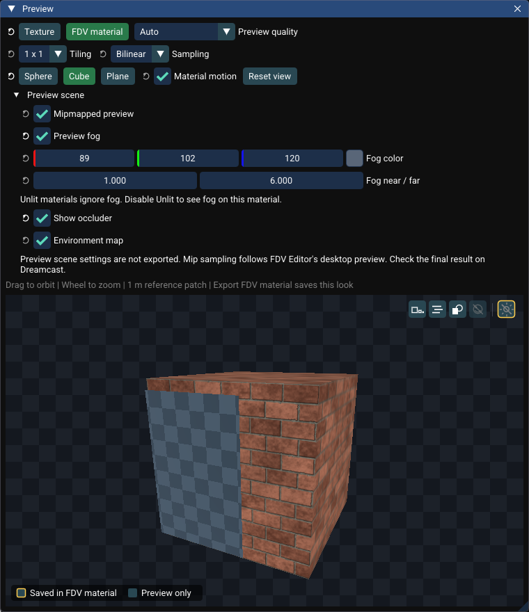

| Control               | What to check                                                                                          |
| :-------------------- | :----------------------------------------------------------------------------------------------------- |
| **Preview fog**       | Adjust color and near/far distances. Enable the material's **Fog** switch. Unlit materials ignore fog. |
| **Show occluder**     | Toggle the material's **Depth test**. With it off, the material draws through the panel.               |
| **Mipmapped preview** | Inspect distance filtering and the surface and environment mip biases.                                 |

These scene controls are for inspection and are not exported as material settings.

<details>
<summary>Mip bias and encoded texture quality</summary>

Surface bias 4 is neutral. Lower values are sharper and higher values are softer.<br>
Environment bias 0 inherits the surface bias.

Mip sampling follows FDV Editor's desktop convention.<br>
The preview generates its own mip levels and does not show DTEX quantization or VQ compression.

Use **Encode comparison** to inspect encoded pixels, then check final rendering on Dreamcast.<br>
The export's **Mipmaps** option controls whether the DTEX file includes mip levels.

</details>

## Inspect texture channels

1. Switch to **Texture** view and choose an output such as Albedo, Height, or Normal.
2. Use **Inspect** to select RGBA, RGB, Red, Green, Blue, or Alpha.
3. Hold **Ctrl** over the image to read a pixel's RGBA values and coordinates.

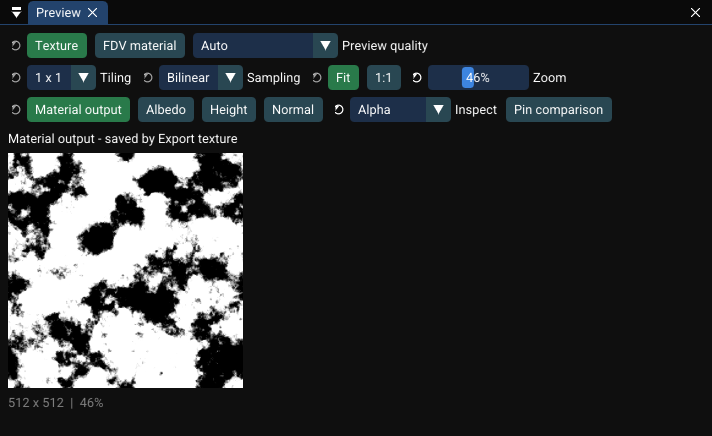

Inspection does not change the graph or exports.<br>
The pixel readout uses the displayed working resolution. Choose **Full quality** to inspect at export resolution.

## Animate and export a sprite sheet

1. Choose an animated preset, or connect **Time** to animation-capable nodes.<br>The Play, Frame, and **Animation...** controls and **Export sprite sheet** appear once a Time node drives the material output.
2. Open **Animation...** and set frame count, FPS, and sheet columns.<br>The **Layout helper** provides a compatible starting layout.
3. Use Play/Pause and the frame slider to inspect the clip.
4. Choose **Export sprite sheet...**, select a destination and format, then save.


_Preview speed changes playback only. Exported timing uses the clip FPS._

PNG preserves transparency.<br>
Keep the exported image and its `.sprites.json` sidecar together. The JSON describes frame rectangles, FPS, and duration.<br>
Enable **Include OBJ/MTL preview** in **Animation...** to also write a quad showing frame 1. The file name must not contain spaces.

<details>
<summary>Export dialog and atlas limits</summary>


Frames run left to right, then top to bottom.<br>
The repeated loop endpoint is omitted. Unused PNG cells remain transparent.

| Atlas type              | Limit                                                |
| :---------------------- | :--------------------------------------------------- |
| Image                   | 8192 pixels per edge and 16 million pixels in total  |
| Direct Dreamcast export | Supported power-of-two dimensions, up to 1024 × 1024 |

The Layout helper offers a 16-frame, four-column starting layout.<br>
Atlas cells have no padding. Sample within each frame's rectangle in your game.

</details>

## Convert and compare

1. Open a file in **Texture Converter**, or choose **Use in Texture Converter** in Texture Creator.<br>For an animated graph, the converter receives the current animation frame as a still image.
2. Set the size before generating mip levels. Choose a filter and edge handling.
3. Select the container and encoding options.
4. Click **Encode comparison** to check the encoded result.<br>Use **Compare** for side-by-side, wipe, or amplified RGB difference views.
5. Export with the required **Format** in the save dialog.


**Alpha matters:** RGB565 and YUV422 discard alpha.<br>
Use ARGB4444 for smooth transparency or reflection masks, or ARGB1555 for binary cutouts.

<details>
<summary>Supported formats and mip levels</summary>

| Format              | Use                                          |
| :------------------ | :------------------------------------------- |
| PNG / JPEG          | Image import and export. PNG supports alpha. |
| DTEX / TEX, DT, PVR | Dreamcast texture containers                 |
| PAL                 | Palette sidecar for paletted textures        |

Encoding options include RGB565, ARGB1555, ARGB4444, YUV422, PAL4, PAL8, BUMP, and NORMAL.<br>
Available combinations depend on the selected container. Keep palette sidecars with their textures.

Select a mip level to inspect it, or replace it with an image of the same size.<br>
PNG/JPEG export writes the selected mip level. Dreamcast texture export can retain the authored mip chain.

The save dialog's **Format** controls the extension.<br>
Renaming an image to `.pvr` does not convert it.

</details>

## Export an FDV material

1. Use the **FDV material** panel on the right of Texture Creator. If it is closed, choose **View > FDV material**.
2. Name the material and set alpha, wrapping, scrolling, tint, and reflections as needed.
3. Review any validation messages.<br>For example, **Use ARGB4444** corrects an encoding that would discard a reflection mask.
4. Click **Export FDV material...** at the bottom of the panel and choose a parent folder.


The export creates a folder containing the `.fdvmat`, textures, and creator graph when available.<br>
Keep this folder together and import it through FDV Editor's material library.

### Include Dreamcast DTEX

DTEX is the texture format used by FDV Engine on Dreamcast.<br>
This checkbox applies to **Export FDV material…**.

| Setting | Exported bundle                                                                                                           |
| :------ | :------------------------------------------------------------------------------------------------------------------------ |
| **Off** | References PNG textures for desktop and image-based workflows.                                                            |
| **On**  | References a surface DTEX and an active environment-map DTEX. PNG copies and the creator graph, when available, are kept. |

Choose the surface pixel format, mipmaps, and VQ compression below the checkbox.<br>
Environment maps have separate controls under **Environment texture options**.<br>
Use an alpha-capable format for transparency or reflection masks. RGB565 cannot preserve them.

<details>
<summary>Bundle contents and validation</summary>

Bundle asset paths are relative. Environment images are included with their own size, filtering, and encoding settings.<br>
Enable **Include OBJ/MTL preview** to also write a 1 m preview quad (`.obj`) and its material (`.mtl`) for FDV Editor, Blender, or web viewers. They carry tint, opacity, Unlit, and the PNG texture. The name must not contain spaces. GLB/glTF export is not available.

Validation checks cover alpha loss, missing environment images, reflective-hole settings, DTEX sizes, and unsupported layouts.<br>
Apply suggested corrections beside each message as needed. Export validates the request before opening the destination picker.

</details>

To read FDV materials, Dreamcast textures, or sprite sheet metadata in another engine, see [File formats](FILE_FORMATS.md).

## Preferences, autosave, and recovery

Open **Settings > Preferences...**.<br>
Choose **Apply** to save settings for future sessions, or **Cancel** to discard changes.

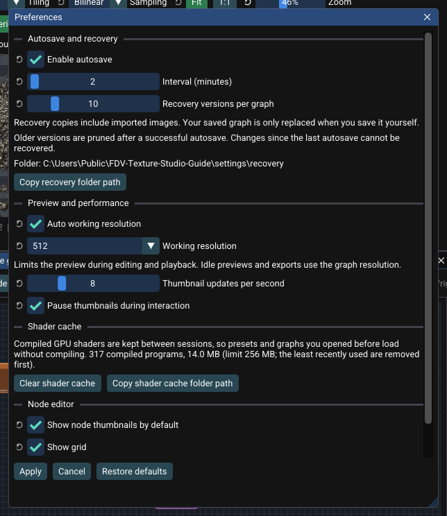

| Setting                                 | Purpose                                                           |
| :-------------------------------------- | :---------------------------------------------------------------- |
| **Enable autosave**                     | Save separate recovery copies, including untitled graphs.         |
| **Interval**                            | 1 to 60 minutes between autosaves. Default: 2 minutes.            |
| **Recovery versions per graph**         | Keep 1 to 50 versions. Default: 10.                               |
| **Working resolution**                  | Limit editing and animation previews to 256, 512, or 1024 pixels. |
| **Thumbnail updates per second**        | Set animated thumbnail updates from 1 to 30 per second.           |
| **Pause thumbnails during interaction** | Prioritize dragging, orbiting, and active edits.                  |
| **Shader cache**                        | Shows the size of the compiled shader cache. **Clear shader cache** empties it. |
| **Node editor defaults**                | Set thumbnail and grid visibility and keep 10 to 200 Undo steps.  |

### Restore an autosave

1. Open **Settings > Recover graph...**, or use the recovery prompt after an interrupted session.
2. Choose a version and click **Restore copy**.
3. Save the recovered graph under the name and location you want.

Autosave includes imported, sampled, and environment images.<br>
It does not overwrite your saved graph. Changes since the last autosave cannot be recovered.

<details>
<summary>Recovery retention and graph compatibility</summary>

Older versions are removed after a successful autosave when the retention limit is reached.<br>
The startup prompt appears once for each interrupted session. Its copies stay available in **Recover graph...**.<br>
Preferences shows the recovery folder path, which you can copy to your file manager.

Graphs using pinned controls, bypass, or reroutes require Texture Studio 0.2.0 or newer.<br>
Graphs with more than 64 nodes require Texture Studio 0.3.0 or newer.

</details>

## Report a problem

[Open an issue](https://github.com/freakdave/FDV-Texture-Studio/issues) with:

- App version and operating system
- Graphics renderer shown in the status bar
- Steps to reproduce the problem
- A screenshot or small example graph, if useful and suitable for public sharing
