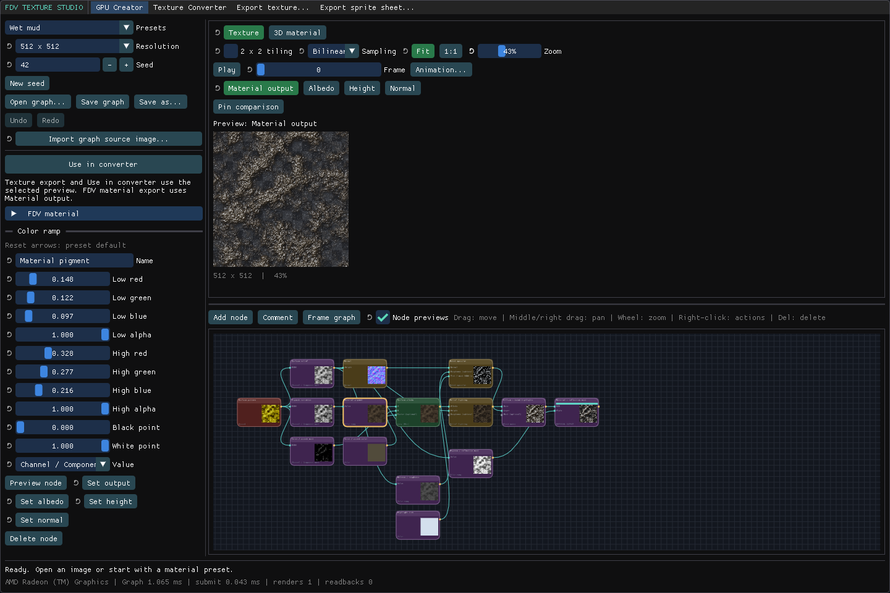
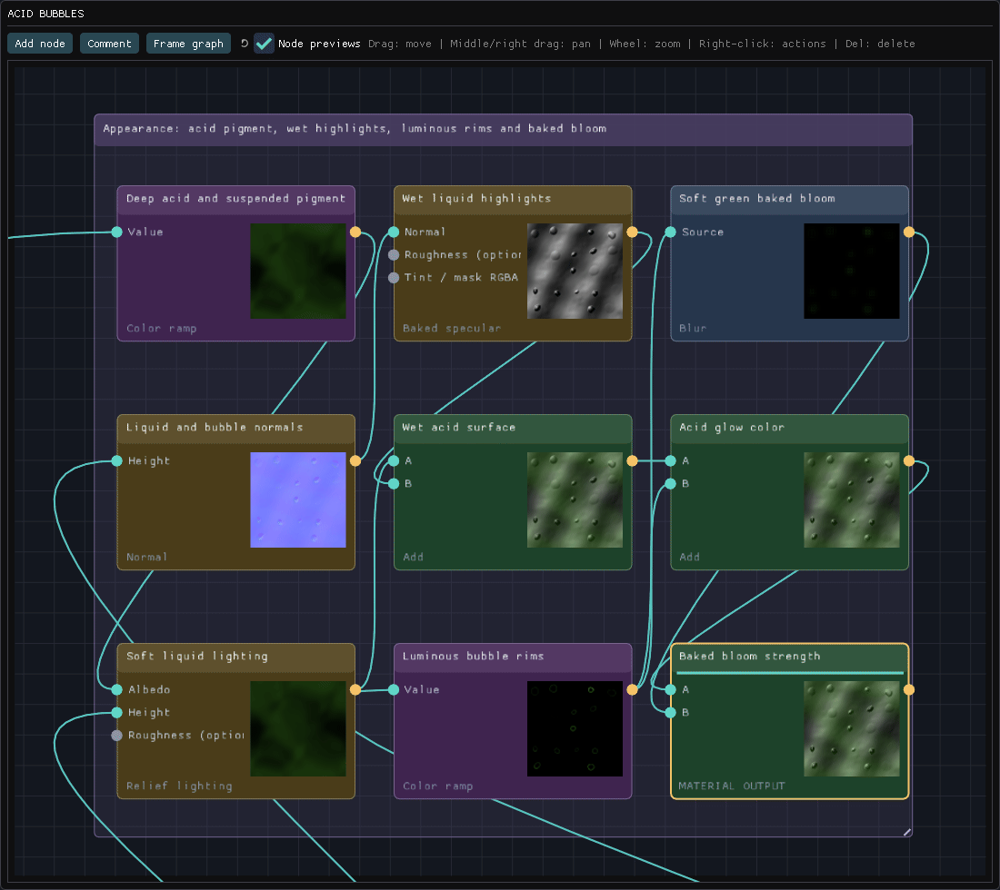
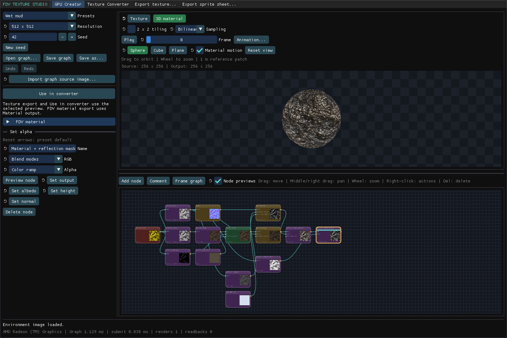
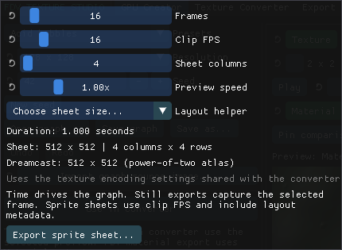
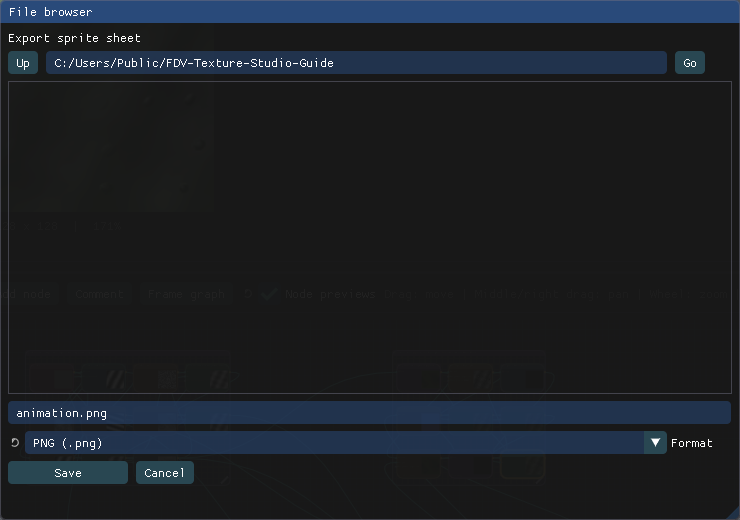
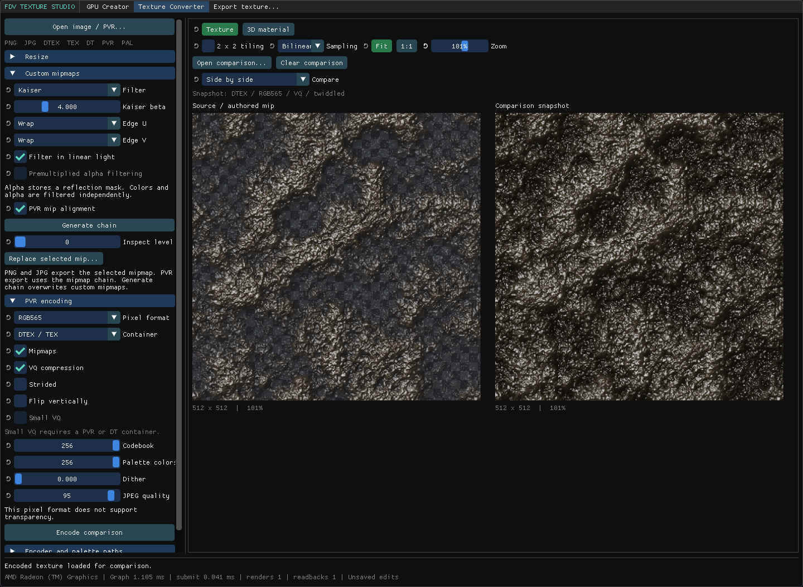
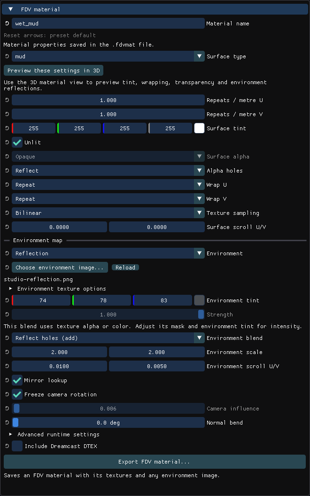

# FDV Texture Studio · User guide

[← Back to the README](../README.md)

[Create and edit](#create-and-edit) · [3D preview](#preview-materials) ·
[Animation and sprite sheets](#animate-and-export-a-sprite-sheet) ·
[Conversion](#convert-and-compare) · [FDV materials](#export-an-fdv-material)

## Start here

Download a package from the repository's **Releases** page. On Windows, run the
installer or extract the portable ZIP and launch `fdv-texture-studio.exe`.
On Linux, install the DEB or extract the portable ZIP and run
`launch-texture-studio.sh`.

The release includes the native PVR encoder. You do not need a compiler, KOS,
or WSL to use the application. Linux needs glibc 2.38 or newer, X11/XWayland,
and an OpenGL 3.3 driver. If the status bar reports **CPU rendering fallback**,
the system is using software rendering. Check your graphics driver.

## Create and edit

Choose a preset in **GPU Creator**, then select a resolution and seed.
The preset menu searches names, categories, and descriptions. Each preset is an
editable graph: select a node to adjust its settings and connections.

The preset, resolution, and seed controls are at the upper left. Select a node
in the graph to show its settings below them. This example has **Material pigment**
selected, which exposes the color ramp.

| Action                 | Control                                                                 |
| :--------------------- | :---------------------------------------------------------------------- |
| Pan the graph          | Drag with the middle or right mouse button.                             |
| Zoom the graph         | Mouse wheel.                                                            |
| Connect nodes          | Drag between pins, or click each pin in turn.                           |
| Add a connected node   | Drag a pin onto empty canvas, then search for a node.                   |
| Disconnect an input    | Right-click its pin.                                                    |
| Select several nodes   | Shift-click or drag a selection box on empty canvas.                    |
| Group a selection      | Press **C** or choose **Comment**.                                      |
| Inspect a node's image | Double-click the node.                                                  |
| Open node actions      | Right-click the node.                                                   |
| Enter a precise value  | Double-click or Ctrl+click a numeric slider.                            |
| Reset one setting      | Click its reset arrow, or right-click and choose **Revert to default**. |

Nodes have dark colors by category: green for math and masks, red for material
patterns, burnt orange for generators, purple for color and channels, slate blue
for filters, ochre for normals and lighting, teal for coordinates, plum for
animation, and indigo for textures.

Use **Texture sample** to combine independent images or preset snapshots.
**Source image (shared)** uses the graph's shared imported image. Save with
**Save graph** to retain your edits. Keep copied source images beside the graph
when moving it to another folder or computer.

Use **Presets → Custom → Save current as custom preset...** to add your graph
to the library. Selecting a custom preset creates an unsaved working copy.

Thumbnails show each node's output. The example above shows the Acid bubbles
material at several stages. Double-click a node to inspect its output in the
main preview.

## Preview materials

Switch between **Texture** and **3D material** above the preview. In 3D, choose
**Sphere**, **Cube**, or **Plane**, drag to orbit, and use the wheel to zoom.
**Reset view** restores the camera. Enable **2 × 2 tiling** to inspect repeats.
This preview setting does not change your exported texture.

Use the buttons above the mesh to choose a shape or enable tiling. **Material
motion** previews the material's scrolling settings.

Inspect Material output, Albedo, Height, and Normal when the graph provides them.
Texture export uses the selected preview. FDV material export uses Material output.

Wet presets can use the alpha channel for a reflection mask. Their flat texture
preview can show the checkerboard even when the 3D material is opaque.

Many presets bake shading and highlights into the material image. Their FDV
material defaults to **Unlit** to preserve that appearance. Baked highlights stay
fixed in the texture. Environment reflections use the FDV material settings.

## Animate and export a sprite sheet

Choose an animated preset, or connect **Time** to animation-capable nodes.
Use Play/Pause and the frame slider to inspect the clip. **Animation...** sets
frame count, FPS, sheet columns, and preview speed. Preview speed does not change
exported timing.

Open **Animation...** to set the clip and sheet layout. Check the duration and
sheet dimensions before exporting. The **Layout helper** sets a compatible
starting size.

Choose **Export sprite sheet...** and select the format. PNG preserves transparency.
The export includes a `.sprites.json` sidecar describing each frame's rectangle,
FPS, and duration. Frames run left to right, then top to bottom. The repeated loop
endpoint is omitted, and unused PNG cells remain transparent.

Choose the destination, enter a filename, and select the format before clicking
**Save**. Keep the exported image and its `.sprites.json` file together.

Image atlases are limited to 8192 pixels per edge and 16 million pixels in total.
Direct Dreamcast atlases are padded to supported power-of-two dimensions, up to
1024 × 1024. Use the **Layout helper** for a 16-frame, four-column starting layout.
Atlas cells have no padding. Sample within each frame's rectangle in your game.

## Convert and compare

Open an image or Dreamcast texture in **Texture Converter**, or select
**Use in converter** from the creator. Resize explicitly before generating a mip
chain. Choose a filter and edge handling. Inspect individual mip levels or replace
a level with an image of the same size.

Set the encoding options, then use **Encode comparison** to inspect the actual
encoded and decoded pixels. Compare side by side, use a wipe, or amplify the RGB
difference. Supported encoding combinations depend on the selected container.
Paletted textures need their palette sidecar. RGB565 and YUV422 discard alpha.

**Encode comparison** shows the result of the selected encoding settings.
Use **Compare** to switch between side-by-side, wipe, and difference views.
Select a mip level to inspect the smaller textures used at a distance.
This example uses RGB565, which removes alpha. Use ARGB4444 when you need
a graded reflection mask.

The export dialog's **Format** selection controls the extension. Renaming an image
to `.pvr` does not convert it. PNG/JPEG export writes the selected mip level.
Dreamcast texture export can retain the authored mip chain.

## Export an FDV material

Use the **FDV material** panel for runtime settings such as surface identity,
alpha mode, wrapping, repeats, scrolling, tint, and environment reflections.
**Export FDV material** creates a named folder with a `.fdvmat` document,
textures, optional DTEX files, and the creator graph. Import that folder through
FDV Editor's material library workflow.

Give the material a name and check its settings before clicking **Export FDV
material...**. Choose a parent folder when prompted. The export creates a new
folder with the material's name.

Keep the bundle together: its asset paths are relative. Environment images are
included and have their own size, filtering, and Dreamcast encoding settings.
GLB/glTF and OBJ/MTL export are not currently available.

## Report a problem

Include the app version, operating system, graphics renderer shown in the status
bar, steps to reproduce, and a screenshot where useful. Attach a small graph or
texture only if you are comfortable sharing it publicly.
